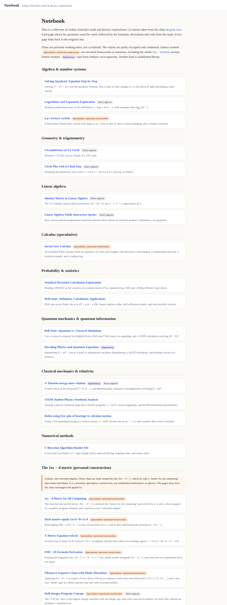
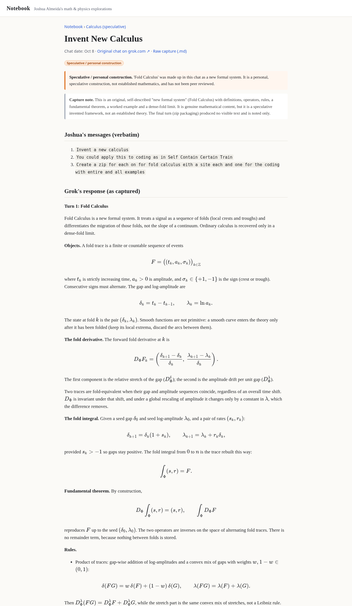
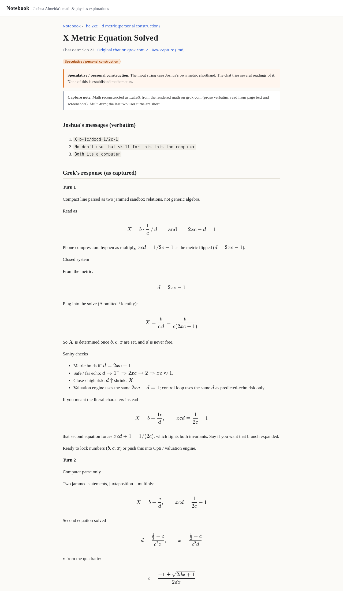

# Notebook

**Live site:** https://fitzyracing1.github.io/notebook/

Notebook collects Joshua Almeida's math and physics explorations. All 22 entries come from his chats on [grok.com](https://grok.com). Each entry has its own page with:

- Joshua's questions, word for word,
- the formulas, derivations and code from the reply (math rendered with [KaTeX](https://katex.org)),
- a link back to the original grok.com chat, and
- the raw markdown capture it was built from.

Topics are grouped into algebra and number systems, geometry and trigonometry, linear algebra, calculus, probability and statistics, quantum mechanics, classical mechanics and relativity, numerical methods, and the 2xc − d metric (Joshua's personal construction).

## A note on what this is

These are personal working notes, not a textbook, and nobody has peer reviewed them. The replies are partly excerpted and condensed (each page's capture note says what was summarized). Two kinds of entries are labeled on the site:

- **Speculative / personal construction**: invented frameworks or notations. Examples are "Fold Calculus" (from *Invent New Calculus*) and the custom u/p/i ternary system. Neither is established theory.
- **The 2xc − d metric (personal construction)**: a whole section of six entries built on Joshua's own invented rule 2xc − d = 1 (the "metric for all computing") and related shorthand. Every entry in it is labeled speculative. Any dollar figures that appear there come from an ad-hoc program in the chat and are not real valuations.
- **Exploratory**: entries that start from Joshua's own equations, such as π² = E·m − c, which the chat itself shows is dimensionally inconsistent.

Entries tagged **Short capture** come from brief chats. They are kept so the collection stays complete.

## Layout

```
entries/          raw markdown captures (one per chat), the source of truth
src/catalog.json  category, one-line summary and status label for each entry
src/style.css     site stylesheet
build.js          small generator: markdown + KaTeX (server-side) -> _site/
scripts/check.js  sanity checks run in CI
docs/             screenshots
```

## Run locally

You need Node 20+.

```sh
npm ci
npm test          # builds _site/ and runs the checks
npm run serve     # serves _site/ at http://localhost:8080 (needs python3)
```

There are two runtime dependencies: `marked` for markdown and `katex` for math. KaTeX's CSS and fonts get copied into the built site, so the published pages make no CDN requests.

## Deployment

On every push to `main`, `.github/workflows/ci.yml` builds and checks the site, and `.github/workflows/pages.yml` builds it and deploys it to GitHub Pages.

## Screenshots

| Index | Entry page | Metric entry |
|---|---|---|
|  |  |  |

## License

MIT, see [LICENSE](LICENSE).
